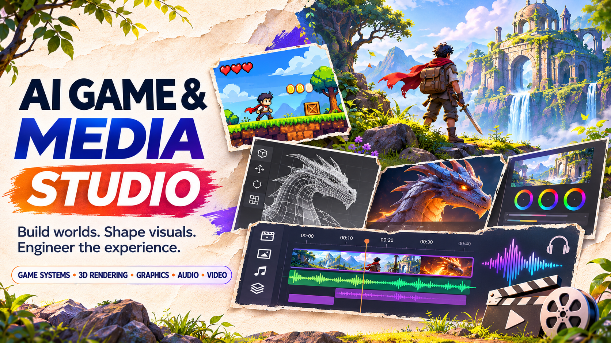
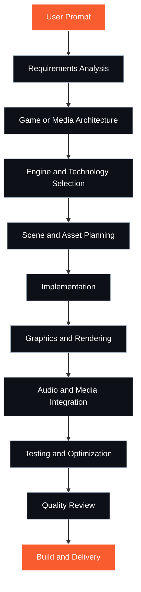

<div align="center">

   

**Coordinated game systems, 3D rendering, graphics, audio, and media pipelines for AI-driven development.**

[Quick Start](#quick-start) • [Master Skill](#master-skill-architecture) • [Modules](#internal-specialist-modules) • [Workflow](#game-and-media-development-workflow) • [Installation](#claude-code-installation) • [Documentation](#documentation-and-resources)

</div>

---

## About AI Game & Media Studio

AI Game & Media Studio orchestrates end-to-end game and media development workflows through a single coordinated Master Skill. Build playable experiences, real-time rendering systems, graphics pipelines, audio processing, and multimedia applications with measurable performance, coherent art direction, and accessible controls.

This repository provides intelligent coordination of specialist engineering disciplines—game systems, 3D rendering, graphics programming, audio engineering, video processing, and human-centered design—through one discoverable entry point that loads relevant modules as needed.

## Project Overview and Statistics

| Metric | Value | Description |
|--------|-------|-------------|
| **Discoverable Skills** | 1 | Single Master Skill entry point |
| **Internal Modules** | 8 | Specialist engineering playbooks |
| **Human-Centered Modules** | 3 | Design quality and UX modules |
| **Installation Methods** | 2 | Claude Code and OpenCode support |
| **Template Types** | 2 | Decision logs and delivery reports |

## What Can You Build?

### Game Development
- **2D and 3D Games** — Platform games, action games, puzzle games, strategy games
- **Game Systems** — Game loops, state management, input handling, collision detection
- **Scene Architecture** — Entity-component systems, scene graphs, asset pipelines
- **Gameplay Logic** — Character controllers, AI behavior, physics integration

### Graphics and Rendering
- **Real-Time Rendering** — Forward and deferred rendering, post-processing effects
- **3D Visualization** — Scientific visualization, architectural rendering, data visualization
- **Materials and Lighting** — PBR materials, dynamic lighting, shadow mapping
- **Shader Engineering** — Vertex shaders, fragment shaders, compute shaders

### Audio and Media
- **Audio Processing** — Audio synthesis, effects processing, spatial audio
- **Audio Engineering** — Audio mixing, mastering, dynamic range control
- **Video Processing** — Video encoding, transcoding, real-time effects
- **Multimedia Pipelines** — Asset conversion, format optimization, streaming

### Design and Experience
- **Interface Design** — Game UI/UX, HUD design, menu systems
- **Player Experience** — Control schemes, feedback systems, accessibility
- **Visual Hierarchy** — Typography, spacing, information architecture
- **Quality Review** — Design critique, usability assessment, polish

## Master Skill Architecture

This repository exposes **one discoverable Master Skill**: `ai-game-media-studio`

Users invoke only the Master Skill. Internal specialist modules are reference playbooks loaded automatically by the coordinated workflow based on project requirements. Do not select individual modules manually.

```
ai-game-media-studio (Master Skill)
├── Analyzes user requirements
├── Loads relevant specialist modules
├── Coordinates end-to-end workflow
└── Delivers integrated solution
```

**Verification**: All module names and counts confirmed against [skill-manifest.json](skill-manifest.json)

## Internal Specialist Modules

| Module | Engineering Discipline | Role |
|--------|----------------------|------|
| **game-engine-engineer** | Game Systems | Game loops, state management, input handling, physics integration |
| **3d-rendering-engineer** | 3D Rendering | Scene graphs, rendering pipelines, camera systems, transforms |
| **graphics-engineer** | Graphics Programming | Shaders, materials, lighting, visual effects, GPU optimization |
| **audio-engineer** | Audio Engineering | Audio processing, synthesis, spatial audio, mixing |
| **video-processing-engineer** | Video Processing | Video encoding, transcoding, effects, streaming pipelines |
| **human-centered-product-design** | Product Design | Interface design, visual hierarchy, interaction patterns |
| **design-quality-critic** | Design Review | Design critique, quality assessment, polish recommendations |
| **product-experience-engineer** | UX Engineering | Player experience, accessibility, control schemes, feedback |

**Total Modules**: 8 specialist references • 3 human-centered quality modules

## Game and Media Development Workflow



**Adaptive Workflow**: Not every project requires every stage. The Master Skill adapts to actual project type and requirements.

## Game Engine Architecture

### Core Systems
- **Game Loop** — Fixed timestep, variable rendering, frame-independent logic
- **State Management** — Game states, scene transitions, save/load systems
- **Input Handling** — Keyboard, mouse, gamepad, touch, input mapping
- **Entity Management** — Entity-component systems, object pooling, lifecycle

### Scene and Assets
- **Scene Graphs** — Hierarchical transforms, parent-child relationships, culling
- **Asset Pipelines** — Asset loading, caching, streaming, memory management
- **Resource Management** — Texture atlases, mesh batching, LOD systems

### Integration Notes
- Game engine integration requires engine-specific SDKs and build tools
- Unity, Unreal Engine, Godot, and custom engines supported via development guidance
- Actual engine installation and licensing is user responsibility
- Verify engine availability in your environment before starting projects

## 2D and 3D Game Development

### 2D Game Development
- **2D Rendering** — Sprite rendering, tile maps, parallax scrolling
- **2D Physics** — Box2D integration, collision shapes, constraints
- **2D Animation** — Sprite animation, skeletal animation, state machines
- **Camera Systems** — Viewport management, follow cameras, camera effects

### 3D Game Development
- **3D Rendering** — Mesh rendering, instancing, frustum culling
- **3D Physics** — Rigid body dynamics, collision detection, raycasting
- **3D Animation** — Skeletal animation, blend trees, inverse kinematics
- **Camera Systems** — First-person, third-person, orbit cameras, camera rigs

## Graphics Programming

### Rendering Fundamentals
- **Rendering Pipelines** — Forward rendering, deferred rendering, hybrid approaches
- **Draw Calls** — Batching, instancing, indirect rendering, GPU culling
- **Buffer Management** — Vertex buffers, index buffers, uniform buffers
- **Texture Management** — Texture formats, mipmapping, compression, streaming

### Visual Effects
- **Post-Processing** — Bloom, tone mapping, color grading, depth of field
- **Particle Systems** — GPU particles, sprite particles, trail effects
- **Screen-Space Effects** — SSAO, SSR, SSGI, screen-space shadows
- **Volumetric Effects** — Fog, volumetric lighting, atmospheric scattering

### Graphics API Support
- **OpenGL** — Cross-platform graphics programming guidance
- **WebGL** — Browser-based 3D graphics and shader development
- **Metal/DirectX** — Platform-specific rendering guidance where applicable
- **Vulkan** — Low-level graphics API patterns and best practices

**Note**: Actual graphics API availability depends on your development environment and target platform.

## 3D Rendering and Visualization

### Rendering Systems
- **Scene Rendering** — Render passes, render targets, render queues
- **Camera Management** — Projection matrices, view frustum, camera stacks
- **Transform Systems** — World space, view space, clip space, screen space
- **Culling Systems** — Frustum culling, occlusion culling, distance culling

### Scientific and Data Visualization
- **Data Rendering** — Point clouds, volume rendering, isosurfaces
- **Graph Visualization** — Node-edge graphs, force-directed layouts, hierarchies
- **Terrain Rendering** — Heightmaps, terrain LOD, texture splatting
- **Procedural Generation** — Noise functions, procedural meshes, PCG systems

## Materials, Lighting and Shaders

### Material Systems
- **PBR Materials** — Metallic-roughness workflow, specular-glossiness workflow
- **Material Properties** — Albedo, metallic, roughness, normal, emission
- **Texture Mapping** — UV mapping, triplanar mapping, procedural textures
- **Material Variants** — Material instances, dynamic materials, parameter blending

### Lighting Systems
- **Light Types** — Directional, point, spot, area lights
- **Dynamic Lighting** — Real-time shadows, dynamic GI, light probes
- **Baked Lighting** — Lightmaps, reflection probes, ambient occlusion
- **Advanced Lighting** — Volumetric lighting, caustics, subsurface scattering

### Shader Engineering
- **Vertex Shaders** — Vertex transformation, skinning, displacement
- **Fragment Shaders** — Surface shading, lighting calculations, effects
- **Compute Shaders** — GPU compute, particle simulation, post-processing
- **Shader Optimization** — ALU cost, texture sampling, branch reduction

**Shader Development**: GLSL, HLSL, and shader graph guidance provided. Shader compilation and runtime execution requires appropriate graphics backend.

## Audio Engineering and Processing

### Audio Systems
- **Audio Sources** — 2D audio, 3D spatial audio, audio groups
- **Audio Mixing** — Volume control, pitch control, effects chains
- **Audio Effects** — Reverb, delay, filters, distortion, compression
- **Dynamic Range** — Ducking, sidechain compression, dynamic EQ

### Audio Processing
- **Audio Synthesis** — Oscillators, envelopes, LFOs, modulation
- **Signal Processing** — FFT analysis, spectral processing, convolution
- **Audio Streaming** — Streaming audio, buffering, format conversion
- **Synchronization** — Audio-video sync, beat detection, timing

### Audio Pipeline
- **Asset Integration** — Audio file formats, compression, import settings
- **Spatial Audio** — 3D audio positioning, attenuation, occlusion
- **Music Systems** — Layered music, interactive music, transitions
- **Voice Integration** — Dialog systems, voice processing, lip sync

**Audio Tools**: Guidance provided for audio development workflows. External audio tools (DAWs, audio middleware) require separate installation.

## Video and Multimedia Processing

### Video Processing
- **Video Encoding** — H.264, H.265, VP9, AV1 codec guidance
- **Video Transcoding** — Format conversion, resolution scaling, bitrate control
- **Video Effects** — Real-time effects, filters, transitions, compositing
- **Streaming** — Video streaming protocols, adaptive bitrate, low-latency

### Multimedia Pipelines
- **Asset Conversion** — Image, audio, video format conversion workflows
- **Batch Processing** — Automated asset processing, optimization pipelines
- **Quality Control** — Visual quality assessment, compression artifact detection
- **Format Optimization** — Platform-specific format recommendations

**Processing Requirements**: Video and multimedia processing guidance provided. External tools (FFmpeg, media frameworks) require separate installation and configuration.

## Human-Centered Product Design

The Master Skill integrates three human-centered design modules to ensure professional quality across all user-facing aspects:

### Design Principles
- **Visual Hierarchy** — Clear information priority, scannable layouts, focus management
- **Typography** — Readable fonts, appropriate sizing, consistent text styles
- **Spacing and Layout** — Consistent margins, logical grouping, breathing room
- **Color and Contrast** — Sufficient contrast ratios, color-blind considerations

### Game Interface Design
- **HUD Design** — Minimal obstruction, clear feedback, contextual information
- **Menu Systems** — Clear navigation, consistent patterns, state indication
- **Control Schemes** — Intuitive mappings, customizable controls, haptic feedback
- **Player Feedback** — Visual feedback, audio feedback, animation feedback

### Quality Review Process
1. **Design Critique** — Professional assessment of visual design, interaction patterns
2. **Usability Assessment** — Control scheme evaluation, learning curve analysis
3. **Accessibility Review** — Color contrast, text sizing, control alternatives
4. **Polish Recommendations** — Visual refinement, interaction improvements

**Quality Gates**: Human-centered design modules are applied throughout development, not as final decoration.

## Design Quality Review

### Review Dimensions
- **Functionality** — Does it work as intended? Clear purpose? Complete implementation?
- **Usability** — Intuitive controls? Clear feedback? Learnable patterns?
- **Visual Design** — Professional appearance? Consistent style? Appropriate hierarchy?
- **Performance** — Smooth frame rates? Responsive controls? Efficient rendering?
- **Accessibility** — Sufficient contrast? Readable text? Alternative inputs?

### Review Process
1. **Initial Review** — Assess current state against quality dimensions
2. **Issue Identification** — Document specific problems with severity levels
3. **Recommendations** — Provide actionable improvement suggestions
4. **Re-Review** — Verify fixes and improvements

## Quick Start

### Project-Local Installation

Copy the Master Skill into your project:

```bash
# Create .claude/skills directory if it doesn't exist
mkdir -p .claude/skills

# Copy entire ai-game-media-studio folder
cp -r path/to/ai-game-media-studio/.claude/skills/ai-game-media-studio .claude/skills/
```

Verify the skill structure:

```
your-project/
└── .claude/skills/ai-game-media-studio/
    ├── SKILL.md
    ├── references/
    ├── templates/
    └── scripts/
```

### Basic Usage

Invoke the Master Skill with your project requirements:

```text
Create a 2D platformer game with physics and particle effects
```

The Master Skill automatically:
1. Analyzes requirements
2. Loads relevant specialist modules
3. Coordinates implementation
4. Validates deliverables

## Claude Code Installation

### Skill Discovery

Claude Code automatically discovers skills in `.claude/skills/` directories.

### Invocation

```text
/ai-game-media-studio
```

Or describe your project naturally:

```text
Build a 3D rendering engine with PBR materials and dynamic lighting
```

Claude Code will recognize relevant capabilities and load the Master Skill.

### Verification

Check skill availability:

```text
/skills
```

Confirm `ai-game-media-studio` appears in the available skills list.

## OpenCode Installation

### Skill Discovery

OpenCode discovers skills using the `@` mention syntax.

### Invocation

```text
@ai-game-media-studio
```

Or use natural language:

```text
@ai-game-media-studio Create an audio processing pipeline with real-time effects
```

### Verification

OpenCode agent discovery behavior may vary by version. Confirm the skill appears in your agent's available skill list before relying on it.

## Supported Game Engines and Technologies

### Game Engines

Development guidance provided for:

- **Unity** — C# scripting, scene management, component systems
- **Unreal Engine** — Blueprint systems, C++ integration, rendering systems
- **Godot** — GDScript, scene trees, node systems
- **Custom Engines** — Architecture patterns, engine design, system integration

**Installation**: Game engines require separate installation, licensing, and configuration. Verify engine availability before starting projects.

### Graphics Technologies

- **OpenGL** — Cross-platform graphics programming
- **WebGL** — Browser-based 3D graphics
- **Shader Languages** — GLSL, HLSL, shader graphs
- **Rendering Techniques** — Forward, deferred, hybrid pipelines

### Audio Technologies

- **Audio APIs** — Web Audio API, platform audio systems
- **Audio Formats** — WAV, MP3, OGG, FLAC support guidance
- **Audio Middleware** — Integration patterns for Wwise, FMOD (separate licensing)

### Development Tools

- **Version Control** — Git workflows for game development
- **Build Systems** — CMake, Make, engine-specific build tools
- **Testing Tools** — Unit testing, integration testing, performance profiling

**Capability Boundaries**: This repository provides development guidance, architecture patterns, and implementation coordination. It does not include pre-installed game engines, licensed middleware, or external media-generation tools.

## Graphics and Rendering Configuration

### Graphics Backend Setup

**OpenGL Projects**:
```bash
# Install OpenGL development libraries (platform-specific)
# Linux:
sudo apt-get install libgl1-mesa-dev libglu1-mesa-dev

# macOS:
# OpenGL included with Xcode Command Line Tools

# Windows:
# OpenGL headers included with graphics drivers
```

**WebGL Projects**:
- No installation required
- Works in modern browsers with WebGL 2.0 support
- Test browser compatibility before deployment

### Shader Development

**GLSL Shader Files**:
```bash
project/
├── shaders/
│   ├── vertex.glsl
│   ├── fragment.glsl
│   └── compute.glsl
```

**Shader Compilation**:
- Runtime shader compilation in development
- Pre-compiled shaders for production builds
- Shader validation tools recommended

### Rendering Configuration

**Performance Settings**:
- Resolution targets (1080p, 1440p, 4K)
- Frame rate targets (30fps, 60fps, 144fps)
- Quality presets (low, medium, high, ultra)
- Dynamic resolution scaling

**Graphics API Selection**:
- Choose based on target platform
- Consider cross-platform requirements
- Verify hardware support

## Audio and Video Processing Requirements

### Audio Processing Setup

**Audio Libraries**:
- Web Audio API (browser-based projects)
- Platform-specific audio APIs (native projects)
- Audio middleware SDKs (if using Wwise, FMOD, etc.)

**Audio Asset Pipeline**:
```bash
project/
├── audio/
│   ├── music/
│   ├── sfx/
│   └── voice/
```

**Audio Formats**:
- Development: WAV (uncompressed)
- Production: OGG Vorbis, MP3 (platform-dependent)
- Compression settings: Balance quality and file size

### Video Processing Setup

**Video Processing Tools** (separate installation required):
- FFmpeg for video encoding/transcoding
- Media frameworks for real-time processing
- Platform-specific codecs

**Video Pipeline**:
```bash
# Example FFmpeg usage (requires separate installation)
ffmpeg -i input.mp4 -c:v libx264 -preset medium -crf 23 output.mp4
```

**Video Formats**:
- H.264 for broad compatibility
- H.265 for better compression (verify browser support)
- WebM for web delivery

## Performance Optimization

### Rendering Performance

**Frame Time Measurement**:
```javascript
// Example performance monitoring
let frameStart = performance.now();
// ... render frame ...
let frameTime = performance.now() - frameStart;
console.log(`Frame time: ${frameTime.toFixed(2)}ms`);
```

**Optimization Techniques**:
- **Draw Call Reduction** — Batching, instancing, atlasing
- **GPU Optimization** — Shader simplification, texture compression
- **Memory Management** — Object pooling, asset streaming, LOD systems
- **Culling** — Frustum culling, occlusion culling, distance culling

### Asset Optimization

**Texture Optimization**:
- Appropriate resolutions for target platform
- Texture compression (DXT, ASTC, ETC2)
- Mipmapping for distant objects
- Texture atlasing for UI and sprites

**Mesh Optimization**:
- Polygon reduction for distant objects
- LOD (Level of Detail) systems
- Mesh compression and quantization
- Efficient vertex formats

**Audio Optimization**:
- Compressed audio formats in production
- Streaming for long audio files
- Appropriate sample rates (44.1kHz, 48kHz)
- Mono vs. stereo considerations

### Profiling and Measurement

**Performance Metrics**:
- Frame time and FPS
- Draw calls per frame
- Memory usage (RAM and VRAM)
- Load times and streaming performance

**Profiling Tools**:
- Browser DevTools for WebGL projects
- Engine profilers (Unity Profiler, Unreal Insights)
- Platform-specific profilers (Xcode Instruments, Android Profiler)

## Testing and Quality Assurance

### Automated Testing

**Unit Tests**:
- Game logic and state management
- Math utilities and collision detection
- Audio processing algorithms
- Video processing pipelines

**Integration Tests**:
- Scene loading and transitions
- Asset pipeline validation
- Rendering system integration
- Audio system integration

### Manual Testing

**Functionality Testing**:
- Core gameplay mechanics
- Control schemes on target devices
- Audio-visual synchronization
- Save/load systems

**Performance Testing**:
- Frame rate on target hardware
- Memory usage over time
- Load time measurements
- Thermal performance on mobile

### Quality Validation

**Visual Quality**:
- Rendering correctness
- Material appearance
- Lighting quality
- Post-processing effects

**Audio Quality**:
- Audio clarity and balance
- Spatial audio accuracy
- Music transitions
- Sound effect timing

**User Experience**:
- Control responsiveness
- Interface usability
- Accessibility features
- Player feedback clarity

## Build and Deployment Guide

### Development Builds

**Debug Builds**:
- Unoptimized code for debugging
- Verbose logging enabled
- Development tools included
- No asset compression

**Testing Builds**:
- Moderate optimization
- Performance profiling enabled
- Test-specific features
- Representative asset quality

### Production Builds

**Release Configuration**:
- Full optimization enabled
- Logging reduced or removed
- Asset compression and optimization
- Platform-specific packaging

**Platform-Specific Builds**:
```bash
# Example build commands (engine-dependent)

# Unity example:
# Unity Build Settings > Build

# Unreal example:
# File > Package Project > [Platform]

# Custom engine example:
# cmake --build . --config Release
```

### Build Validation

**Pre-Release Checklist**:
- [ ] All tests passing
- [ ] Performance targets met
- [ ] Asset optimization complete
- [ ] Platform compliance verified
- [ ] No debug code in production
- [ ] No secrets in build
- [ ] Version numbers updated
- [ ] Documentation current

### Deployment

**Distribution Platforms**:
- Steam, Epic Games Store, GOG (PC)
- App Store, Google Play (Mobile)
- Nintendo eShop, PlayStation Store, Xbox Store (Console)
- Itch.io, GameJolt (Indie)
- Web hosting (WebGL builds)

**Deployment Requirements**:
- Platform-specific compliance
- Age ratings and content descriptors
- Privacy policies (if collecting data)
- Terms of service
- Asset licensing documentation

## Output Structure and Deliverables

### Project Structure

```
project/
├── src/                      # Source code
│   ├── game/                 # Game systems
│   ├── rendering/            # Rendering systems
│   ├── audio/                # Audio systems
│   └── ui/                   # User interface
├── assets/                   # Game assets
│   ├── textures/
│   ├── models/
│   ├── audio/
│   └── shaders/
├── scenes/                   # Scene files
├── build/                    # Build outputs
├── docs/                     # Documentation
│   ├── architecture.md
│   ├── build-guide.md
│   └── performance-report.md
└── tests/                    # Test files
```

### Documentation Deliverables

**Architecture Documentation**:
- System architecture diagrams
- Component relationships
- Data flow documentation
- API documentation

**Build Documentation**:
- Build instructions
- Platform-specific requirements
- Deployment procedures
- Troubleshooting guide

**Performance Reports**:
- Performance metrics and targets
- Optimization techniques applied
- Known performance limitations
- Platform-specific considerations

### Quality Assurance Deliverables

**Test Results**:
- Unit test results
- Integration test results
- Performance test results
- Manual testing reports

**Design Review**:
- Design quality assessment
- Usability findings
- Accessibility review
- Recommended improvements

## Troubleshooting and FAQ

### Common Issues

**Skill Not Discovered**:
- Verify `.claude/skills/ai-game-media-studio/` exists
- Check `SKILL.md` is present
- Confirm agent supports skill discovery
- Restart agent if necessary

**Module Loading Failures**:
- Check `references/` directory structure
- Verify all referenced modules exist
- Review agent error logs
- Validate skill-manifest.json

**Performance Issues**:
- Profile before optimizing
- Check target hardware capabilities
- Verify asset optimization
- Review rendering pipeline efficiency

**Build Failures**:
- Check dependency installation
- Verify toolchain versions
- Review build logs
- Check platform-specific requirements

### Frequently Asked Questions

**Q: Do I need to install game engines separately?**

A: Yes. This repository provides development guidance and coordination. Game engines (Unity, Unreal, Godot) require separate installation and licensing.

**Q: Can I use this for commercial projects?**

A: The Master Skill and modules provide development guidance. Verify licensing for any game engines, middleware, or assets you use in commercial projects.

**Q: Which programming languages are supported?**

A: Language support depends on your chosen game engine and environment. Guidance provided for common game development languages (C#, C++, JavaScript, Python, GDScript).

**Q: Do I need graphics programming experience?**

A: The graphics and rendering modules provide guidance for various skill levels. Basic understanding of 3D math and graphics concepts recommended for advanced features.

**Q: Can this generate game assets?**

A: No. This repository coordinates game and media development workflows. Asset creation requires appropriate tools (3D modeling software, audio tools, image editors).

**Q: How do I add custom specialist modules?**

A: Add new reference playbooks to `references/` directory, update the Master Skill's module map, and update `skill-manifest.json`. Follow existing module structure.

**Q: Can I use this with web-based games?**

A: Yes. WebGL rendering, Web Audio API, and browser-based game development are supported through relevant specialist modules.

**Q: What about mobile game development?**

A: Mobile development guidance provided through game engine modules. Platform-specific requirements, performance optimization, and input handling covered.

## Documentation and Resources

### Internal Documentation

- [Master Skill](.claude/skills/ai-game-media-studio/SKILL.md) — Main coordinated workflow
- [Module Index](.claude/skills/ai-game-media-studio/references/INDEX.md) — Specialist module overview
- [Agent Operating Guide](AGENTS.md) — Agent development and contribution guidelines
- [Skill Manifest](skill-manifest.json) — Module registry and metadata
- [Changelog](CHANGELOG.md) — Version history and updates

### Templates

- [Decision Log](.claude/skills/ai-game-media-studio/templates/decision-log.md) — Architecture decision records
- [Delivery Report](.claude/skills/ai-game-media-studio/templates/delivery-report.md) — Project delivery documentation

### Validation

```bash
# Validate skill structure and integrity
python scripts/validate_pack.py
```

Validation checks:
- Master Skill presence and structure
- Expected reference files
- Frontmatter correctness
- Basic link integrity
- Accidental secrets detection

**Note**: Validation does not guarantee provider/API availability or production behavior.

### External Resources

**Game Development**:
- [Game Programming Patterns](https://gameprogrammingpatterns.com/)
- [Real-Time Rendering Resources](http://www.realtimerendering.com/)
- [Learn OpenGL](https://learnopengl.com/)

**Graphics Programming**:
- [The Book of Shaders](https://thebookofshaders.com/)
- [Graphics Programming Virtual Meetup](https://gpvm.org/)
- [Shadertoy](https://www.shadertoy.com/)

**Audio Engineering**:
- [Web Audio API Documentation](https://developer.mozilla.org/en-US/docs/Web/API/Web_Audio_API)
- [Audio Programming Resources](https://www.musicdsp.org/)

**Game Engines**:
- [Unity Documentation](https://docs.unity3d.com/)
- [Unreal Engine Documentation](https://docs.unrealengine.com/)
- [Godot Documentation](https://docs.godotengine.org/)

---

<div align="center">

**AI Game & Media Studio**

Coordinated game systems, 3D rendering, graphics, audio, and media pipelines.

*Built for AI-driven game and media development workflows*

</div>
